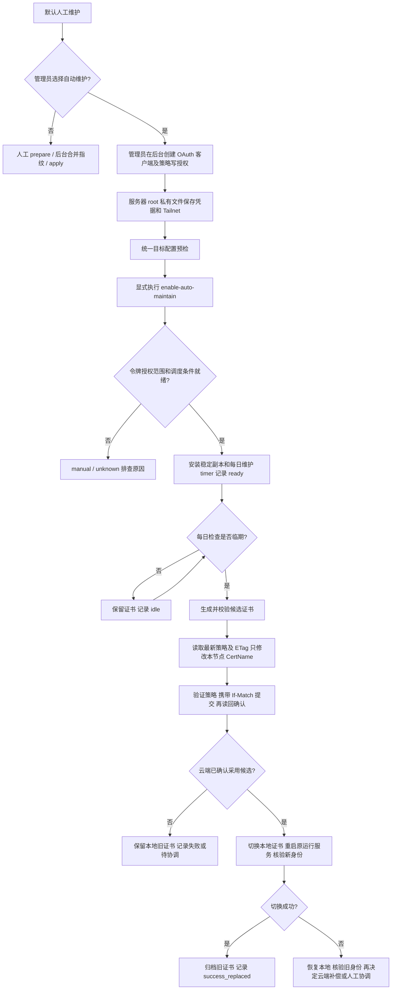

# 证书自动维护：授权、启用与验收

中文 | [English](AUTO_MAINTENANCE_EN.md)

首次部署默认人工维护，不安装自动换证 timer。管理员可以在部署完成后选择启用。本机 tailscaled 已登录，只能证明节点已加入 Tailnet，不能代替策略 API 写授权；启用命令不会弹出浏览器登录、自动创建 OAuth 客户端或代管理员授予权限。

## 三项能力分别选择

| 能力 | 启用方式 | 作用 |
| --- | --- | --- |
| 周期健康检查 | `--install-healthcheck-cron` | 检查健康和证书期限；不更换证书 |
| 自动换证 | 配置 API 凭据后显式 `--enable-auto-maintain` | 每日检查，临期生成候选、同步指纹并切换证书 |
| 站外通知 | 另行配置监控和通知渠道 | 当前脚本不提供邮件、短信或 Webhook 通知 |

## 从人工授权到自动执行



管理员只在创建授权、存放凭据和启用维护时操作；日常轮换不逐次要求登录确认。维护程序由独立 root oneshot 运行，不把凭据交给 derper 服务用户。

## 1. 管理员准备 API 授权

在 Tailscale 管理后台按官方 [OAuth 客户端说明](https://tailscale.com/docs/features/oauth-clients)创建客户端，选择策略文件写权限 `policy_file`，并按后台要求配置依赖权限。`policy_file:read` 只允许读取和验证，不能更新策略。权限定义见[官方 GitOps 说明](https://tailscale.com/docs/integrations/github/gitops)。

API 写权限面向策略文件，不只限于单个 DERP 节点。脚本读取最新整份策略，在内容上只修改本节点 `CertName`，再提交修改后的策略；它并未获得“只能改这一字段”的服务端权限。管理员应据此决定是否在公网 DERP 机上保管该凭据。若采用 GitOps 管理策略，设置 `POLICY_SOURCE=gitops`，保留仓库发布流程，脚本不会直接写云端。

## 2. 在服务器保存凭据

使用 [policy-api.env.example](../examples/policy-api.env.example)作为模板。默认位置为 `/etc/derper/policy-api.env`，属主 root、权限 0600。已有凭据文件应由管理员编辑，不能用模板覆盖。

```text
TS_TAILNET=实际Tailnet名称
TS_API_BASE=https://api.tailscale.com
TS_API_CLIENT_ID=后台创建的ClientID
TS_API_CLIENT_SECRET=后台创建的ClientSecret
POLICY_SOURCE=api
```

这是一份白名单数据文件，值不加 shell 引号，不写变量或命令。真实 secret 仅在服务器私密编辑器中填写，不放在聊天、仓库、普通 `target.conf`、命令行或 unit 中。之后核对属主和权限：

```bash
sudo chown root:root /etc/derper/policy-api.env
sudo chmod 600 /etc/derper/policy-api.env
```

## 3. 用统一目标配置预检和启用

以下路径为示例，先替换为已核验的源码文件和该节点的真实配置。按 [deploy.conf.example](../examples/deploy.conf.example)填写 IP、Region、名称、端口、运行用户、鉴权、安全级别和版本；例如京东云应保持 Region901，而非使用默认900。预检确认现有服务与配置一致后再执行启用；启用命令属于部署入口，参数不一致时可能触发正常的部署修复流程。

```bash
script=/root/derper-install/repo/scripts/deploy_derper_ip_selfsigned.sh
target=/root/derper-install/target.conf
sudo bash "$script" check --config "$target"
sudo bash "$script" deploy --config "$target" \
  --policy-credential /etc/derper/policy-api.env \
  --enable-auto-maintain --non-interactive
```

脚本用客户端凭据向 OAuth token 接口申请访问令牌，检查目标 Tailnet及返回的权限范围。条件不齐时保持 manual/unknown 或报错，不凭本机登录、GET/validate 成功判定可写。timer 安装、启用和 active 检查全部成功后才记录 `ready`。

## 4. 检查调度与运行结果

默认部署状态目录下的记录为 `/var/lib/derper-deploy/maintenance/status`；自定义 `DEPLOY_STATE_DIR` 时以实际路径为准。

```bash
sudo systemctl is-enabled derper-cert-maintain.timer
sudo systemctl is-active derper-cert-maintain.timer
sudo systemctl list-timers derper-cert-maintain.timer --no-pager
sudo systemctl cat derper-cert-maintain.service
sudo cat /var/lib/derper-deploy/maintenance/status
sudo journalctl -u derper-cert-maintain.service -n 50 --no-pager
```

应确认 `intent=enabled`、`scheduler_state=ready`，service 使用稳定副本与正确的维护 `target.conf`。默认每日执行，默认提前30天维护；短期证书及显式提前天数规则见[维护手册](MAINTENANCE_CN.md#证书轮换与条件式自动维护)。oneshot 执行结束后 inactive/dead 可以是正常状态，应结合 `Result`、退出码和持久结果判断。

需要立即执行一次检查时，可以手动启动 service；**若证书已临期，这会执行真实换证和策略写入**：

```bash
sudo systemctl start derper-cert-maintain.service
sudo systemctl show derper-cert-maintain.service -p Result -p ExecMainStatus
```

`ready` 表示授权范围与调度的本地判定就绪，不等于云端写入、客户端传播和失败恢复全部验收通过。首次完整闭环应在隔离资源按[真实验收操作包](ACCEPTANCE_CN.md)执行，保留云端/磁盘/在线证书及合法客户端证据。当前真实云 API 自动换证验收仍单列待办。

## 5. 失败处理、升级和停用

- 策略验证失败或 ETag 冲突：停止本次操作，不切换本地证书，不覆盖他人修改。
- 写入结果不确定：先读回；重试确认云端已是同一候选后可继续本地切换。
- 本地切换失败：只有核验旧身份恢复后才尝试云端字段补偿；无法确认时保留协调材料，管理员处理。
- 云端与本地切换不原子，可能有短暂指纹不匹配窗口；不承诺零中断。
- 凭据撤销或过期会使后续运行失败，结果写本机 journal/状态；没有站外通知时需管理员主动查看。
- 升级源码后需再次使用同一目标显式启用，刷新 timer 使用的稳定副本。

停用示例继续使用第3节的 `script` 和 `target`：

```bash
sudo bash "$script" maintain --config "$target" --disable-auto-maintain
sudo systemctl list-timers derper-cert-maintain.timer --no-pager
sudo cat /var/lib/derper-deploy/maintenance/status
```

停用先持久化意图再移除维护调度，不执行本次换证；必须确认 `intent=disabled` 且调度已移除，删除失败会返回非零。停用维护不会自动撤销后台 OAuth 客户端；若不再使用，由管理员另行撤销授权。健康检查 timer 与自动维护 timer 独立。
