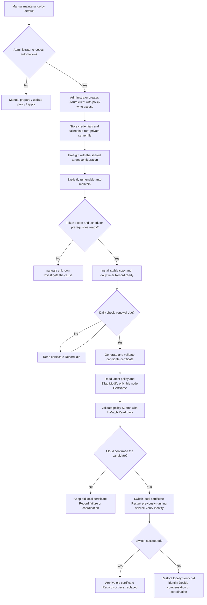

# Automatic certificate maintenance: authorization, activation and acceptance

[中文](AUTO_MAINTENANCE_CN.md) | English

The first deployment defaults to manual maintenance and does not install the certificate maintenance timer. An administrator can enable it later. A logged-in local tailscaled only establishes tailnet enrollment, not policy API write access. Activation does not open a browser login, create an OAuth client, or grant permissions on the administrator's behalf.

## Choose three capabilities separately

| Capability | Activation | Purpose |
| --- | --- | --- |
| Periodic health checks | `--install-healthcheck-cron` | Check health and certificate expiry; do not replace certificates |
| Automatic renewal | Configure API credentials, then explicitly use `--enable-auto-maintain` | Check daily; when renewal is due, prepare a candidate, synchronize the pin and switch the certificate |
| External notifications | Configure monitoring and a notification channel separately | The script currently provides no email, SMS or Webhook notifications |

## From administrator authorization to automatic execution



Administrator actions are needed when creating authorization, storing credentials and activating maintenance. Routine rotations do not require a new login or confirmation each time. A separate root oneshot runs maintenance; credentials are not passed to the derper service user.

## 1. Prepare API authorization

Create a client in the Tailscale admin console using the official [OAuth client instructions](https://tailscale.com/docs/features/oauth-clients). Grant the policy-file write scope `policy_file` and any dependent permissions required by the console. `policy_file:read` permits reading and validation, but cannot update the policy. See the [official GitOps documentation](https://tailscale.com/docs/integrations/github/gitops) for scope definitions.

API write access applies to the policy file, not just one DERP node. The script reads the latest complete policy, changes this node's `CertName` in its contents, and submits the modified policy. It does not have a server-enforced restriction to that single field. The administrator must decide whether to keep this credential on the public DERP server. For GitOps-managed policy, set `POLICY_SOURCE=gitops` and retain the repository publishing workflow; the script will not write directly to the cloud.

## 2. Store credentials on the server

Use [policy-api.env.example](../examples/policy-api.env.example) as the template. The default location is `/etc/derper/policy-api.env`, owned by root with mode 0600. Have the administrator edit an existing credential file; do not overwrite it with the template.

```text
TS_TAILNET=YOUR_TAILNET
TS_API_BASE=https://api.tailscale.com
TS_API_CLIENT_ID=CLIENT_ID_FROM_CONSOLE
TS_API_CLIENT_SECRET=CLIENT_SECRET_FROM_CONSOLE
POLICY_SOURCE=api
```

This is an allowlisted data file. Do not use shell quotes, variables or commands in values. Enter real secrets only in a private editor on the server, never in chat, the repository, ordinary `target.conf`, command-line arguments or units. Check ownership and permissions afterward:

```bash
sudo chown root:root /etc/derper/policy-api.env
sudo chmod 600 /etc/derper/policy-api.env
```

## 3. Preflight and activate with a shared target configuration

The paths below are examples. First substitute verified source files and this node's actual configuration. Use [deploy.conf.example](../examples/deploy.conf.example) to specify the IP, Region, names, ports, service user, client verification, security level and version. For example, the JD Cloud node must retain Region901 instead of defaulting to 900. Activate only after preflight confirms that the existing service matches the configuration. Activation uses the deployment entry point; mismatched settings may trigger the normal deployment repair process.

```bash
script=/root/derper-install/repo/scripts/deploy_derper_ip_selfsigned.sh
target=/root/derper-install/target.conf
sudo bash "$script" check --config "$target"
sudo bash "$script" deploy --config "$target" \
  --policy-credential /etc/derper/policy-api.env \
  --enable-auto-maintain --non-interactive
```

The script requests an access token from the OAuth token endpoint using client credentials, then checks the target tailnet and returned scopes. Missing prerequisites result in manual/unknown or an error. Local enrollment and successful GET/validate requests are not treated as write permission. `ready` is recorded only after timer installation, enablement and the active-state check all succeed.

## 4. Inspect scheduling and results

With the default deployment state directory, the record is `/var/lib/derper-deploy/maintenance/status`. Use the actual location when `DEPLOY_STATE_DIR` is customized.

```bash
sudo systemctl is-enabled derper-cert-maintain.timer
sudo systemctl is-active derper-cert-maintain.timer
sudo systemctl list-timers derper-cert-maintain.timer --no-pager
sudo systemctl cat derper-cert-maintain.service
sudo cat /var/lib/derper-deploy/maintenance/status
sudo journalctl -u derper-cert-maintain.service -n 50 --no-pager
```

Confirm `intent=enabled` and `scheduler_state=ready`, and that the service uses the stable copy with the correct maintenance `target.conf`. The default schedule is daily, with a default renewal lead time of 30 days. See the [maintenance guide](MAINTENANCE_EN.md) for short-lived certificates and explicit lead-time rules. An inactive/dead oneshot can be normal after execution; interpret it together with `Result`, the exit code and the persisted result.

To check immediately, start the service manually. **If renewal is already due, this performs real certificate rotation and policy writes:**

```bash
sudo systemctl start derper-cert-maintain.service
sudo systemctl show derper-cert-maintain.service -p Result -p ExecMainStatus
```

`ready` means the local checks consider the scope and scheduler ready. It does not establish acceptance of cloud writes, client propagation or failure recovery. Perform the first complete cycle on isolated resources using the [real acceptance runbook (Chinese)](ACCEPTANCE_EN.md), retaining cloud, disk, served-certificate and authorized-client evidence. Real cloud API automatic-renewal acceptance remains separately pending.

## 5. Failures, upgrades and disabling

- Policy validation failures or ETag conflicts stop the attempt without switching the local certificate or overwriting another administrator's changes.
- If the write result is uncertain, read back first. A retry may continue the local switch after confirming that the cloud already uses the same candidate.
- After a failed local switch, attempt cloud-field compensation only after verifying that the old identity has been restored. Otherwise retain coordination material for the administrator.
- Cloud updates and the local switch are not atomic. A temporary pin mismatch is possible; zero interruption is not promised.
- Revoked or expired credentials cause subsequent runs to fail. Results remain in the local journal/status; without external notifications, the administrator must inspect them.
- After upgrading the source script, explicitly enable maintenance again with the same target to refresh the stable copy used by the timer.

The disabling example reuses `script` and `target` from step 3:

```bash
sudo bash "$script" maintain --config "$target" --disable-auto-maintain
sudo systemctl list-timers derper-cert-maintain.timer --no-pager
sudo cat /var/lib/derper-deploy/maintenance/status
```

Disabling persists the intent before removing the maintenance schedule and does not rotate the certificate in that run. Confirm `intent=disabled` and schedule removal; removal failures return nonzero. Disabling maintenance does not revoke the OAuth client in the admin console. The administrator must revoke that authorization separately if it is no longer needed. Health-check and certificate-maintenance timers are independent.
