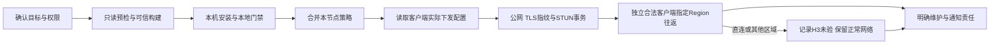

# 安装业务闭环与交接

中文 | [English](INSTALL_WORKFLOW_EN.md)

本页面向操作人员；[代码控制流图](DEPLOY_BUSINESS_FLOW_CN.svg)用于开发审查。系统安装成功、公网可达、策略下发和实际中继通过是四个不同结论。

SSH管理使用系统OpenSSH，经Tailnet传输不等于启用Tailscale SSH。本项目不启用后者，也不要求它；策略中的顶层`ssh`只配置Tailscale SSH授权，不会自行打开服务端功能，亦不控制普通OpenSSH的用户密钥认证。保留既有策略不代表Agent授权启用此功能。

| 阶段 | 完成条件 | 用户 / Agent 交接 |
| --- | --- | --- |
| 目标 | 明确服务器、公网IP、TCP/UDP端口、Region、运行用户和版本 | NAT不能用网卡私网IP替代公网地址；默认TCP30399，可自选空闲端口；443可能占用HTTPS用途 |
| 预检 | `check`退出0；已有服务/端口和sudo条件已核对；构建产物可追溯 | 使用固定源码快照，不把浮动main和已测快照混淆；sudo密码只在用户终端输入；脚本只读预检Region占用，无法确认时人工核对 |
| 本机部署 | 服务、正确进程监听、证书、LocalAPI符合所选范围 | 专用用户、standard、verify-clients默认开启；scope为H0-H2不代表H3通过 |
| 策略合并 | 本节点加入既有Regions，其他规则保留，后台保存成功 | 节点片段不是整份策略；保留grants、ssh和原Regions；读取最新策略复核Region冲突；以脚本实际Region为准，不照抄上游日志示例 |
| 下发 | 客户端`tailscale debug derp-map`中的单节点目标、端口、CertName一致 | `netcheck`看到区域只表示区域探测；后台截图不代替客户端实际下发 |
| 公网 | 从外部网络校验TLS证书摘要、有效STUN Binding响应 | `nc -zvu`可能假阳性，不作为STUN通过；云安全组和主机防火墙须一致 |
| H3 | 合法客户端与独立对端实际经指定Region往返并完成STUN | 直连更优但本次H3未验；不自动封UDP、强制路由或关闭verify-clients；需要受控条件时明确变更与恢复方案 |
| 维护 | 记录证书到期、维护模式、调度状态、通知能力和责任人 | 人工检查、健康timer/cron、自动换证timer、站外通知分别交接，不能从安装成功推断已启用 |

`debug derp`使用临时随机身份，可能被客户端校验正常拒绝。完整探针按[真实验收操作包](ACCEPTANCE_CN.md)执行；不读取节点私钥，不用固定成功脚本代替。

默认人工维护只在执行`status`、`--health-check`或`maintain`等检查时产生相应输出。周期检查需显式选择`--install-healthcheck-cron`并核对实际timer/cron；自动换证还需要明确授权、凭据、目标与调度就绪。当前没有站外通知。具体命令见[维护手册](MAINTENANCE_CN.md)。

公网DERP服务器的Tailnet身份应最小授权；策略调整必须保留合法客户端对derper的必要可见性。仅打tag而移除所有可见性会导致verify-clients拒绝合法节点，需变更后复验。

最终交接保存：源码与二进制摘要、版本、IP/端口/Region、verify-clients状态、已通过/失败/未验层、证书摘要与期限、实际调度及后续责任。隔离云API故障注入、换证传播、长效兼容和GitHub实跑证据单列，不因一次节点安装成功批量关闭。

如管理员后续选择自动换证，请按[自动维护授权、启用与验收](AUTO_MAINTENANCE_CN.md)完成后台 API 授权、root 凭据配置、统一目标预检和维护 timer 验收。该指南区分健康检查、自动换证及站外通知，并说明 ready 不代表真实云端完整闭环已验收。
