# Installation workflow and handoff

[中文](INSTALL_WORKFLOW_CN.md) | English

This page is for operators. The [code control-flow diagram (Chinese)](DEPLOY_BUSINESS_FLOW_CN.svg) is for implementation review. Successful local installation, public reachability, policy distribution and actual relay acceptance are four separate conclusions.

Manage the host using system OpenSSH. Carrying SSH over the tailnet does not enable Tailscale SSH. This project neither enables nor requires that separate feature. The policy's top-level `ssh` section configures Tailscale SSH authorization; it does not enable the server feature or control ordinary OpenSSH key authentication. Preserving an existing policy is not authorization for an Agent to enable that feature.

```mermaid
flowchart LR
  A[Confirm target and permissions] --> B[Read-only preflight and verified build]
  B --> C[Local installation and gates]
  C --> D[Merge this node into policy]
  D --> E[Read configuration distributed to clients]
  E --> F[Public TLS pin and STUN transaction]
  F --> G[Authorized client round trip via target Region]
  G --> H[Assign maintenance and notification responsibility]
  G -->|Direct or another Region| I[Record H3 unverified Keep normal networking]
  I --> H
```

| Stage | Completion criteria | Operator / Agent handoff |
| --- | --- | --- |
| Target | Confirm server, public IP, TCP/UDP ports, Region, service user and version | With NAT, do not substitute the private interface IP. TCP defaults to 30399; another free port is allowed. Port 443 may conflict with HTTPS use. |
| Preflight | `check` exits 0; inspect existing services, ports and sudo prerequisites; build artifacts are traceable | Use a fixed source snapshot, not an unverified floating main. Enter sudo passwords only in the user's terminal. Region occupancy is checked read-only; unresolved results require manual review. |
| Local deployment | Service, correct listening process, certificate and LocalAPI meet the selected scope | Use the dedicated user, standard hardening and enabled client verification. Passing H0–H2 does not establish H3. |
| Policy merge | Add this node to existing Regions, preserve other rules, and save successfully | The node fragment is not a full policy replacement. Preserve grants, ssh and existing Regions. Recheck collisions against the latest policy. Use the actual Region, not an upstream log example. |
| Distribution | Client `tailscale debug derp-map` matches the single target node, ports and CertName | A region appearing in netcheck establishes a region probe only. A console screenshot does not replace the configuration actually distributed to clients. |
| Public access | Verify TLS certificate pin and a valid STUN Binding response from an external network | `nc -zvu` may give false positives. Cloud security groups and host firewall rules must agree. |
| H3 | An authorized client and independent peer complete a round trip via the target Region and STUN | A direct path may be better but leaves this H3 attempt unverified. Do not automatically block UDP, force routes or disable client verification. Any controlled network conditions need a stated change and restoration plan. |
| Maintenance | Record expiry, maintenance mode, schedule state, notifications and owner | Hand off manual checks, health timer/cron, certificate-maintenance timer and external notifications separately. Successful installation does not imply these are enabled. |

`debug derp` uses a temporary random identity that client verification may correctly reject. Follow the [real acceptance runbook (Chinese)](ACCEPTANCE_EN.md) for the full probe; do not read node private keys or replace real relay evidence with a fixed-success script.

Manual maintenance reports relevant information when `status`, `--health-check` or `maintain` runs. Periodic checks require explicit `--install-healthcheck-cron` selection and inspection of the actual timer/cron. Automatic rotation additionally requires authorization, credentials, the target and a working schedule. External notifications are not currently provided. See the [maintenance guide](MAINTENANCE_EN.md).

Minimize privileges for the public DERP host's tailnet identity while preserving visibility of legitimate clients to derper. Merely tagging the host and removing all visibility can cause verify-clients to reject legitimate nodes; revalidate after changes.

Retain the following in the handoff: source and binary hashes, version, IP/ports/Region, client-verification state, passed/failed/unverified layers, certificate pin and lifetime, actual schedules and responsible owner. Track isolated API fault injection, rotation propagation, long-lived compatibility and real GitHub runs separately; one successful installation does not close them all.

To enable automatic renewal later, follow [authorization, activation and acceptance](AUTO_MAINTENANCE_EN.md) for admin API authorization, root credentials, shared-target preflight and timer acceptance. The guide distinguishes health checks, rotation and external notifications, and explains why ready does not establish full real-cloud acceptance.
